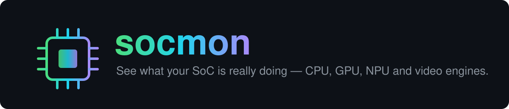
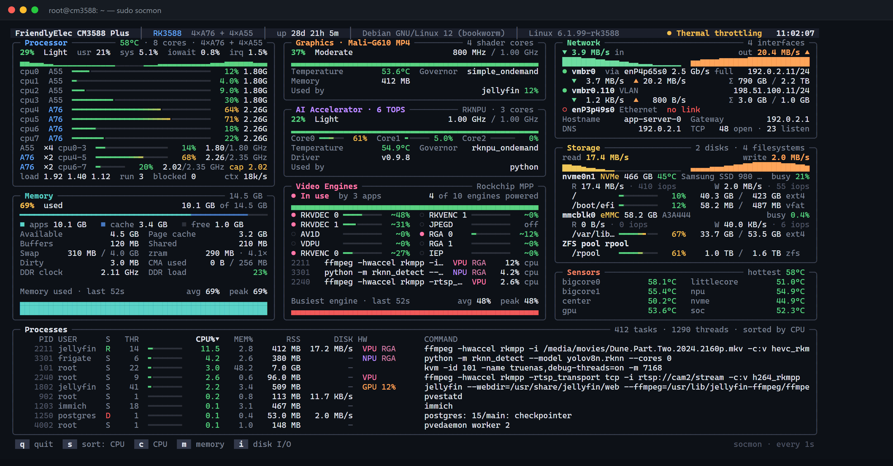
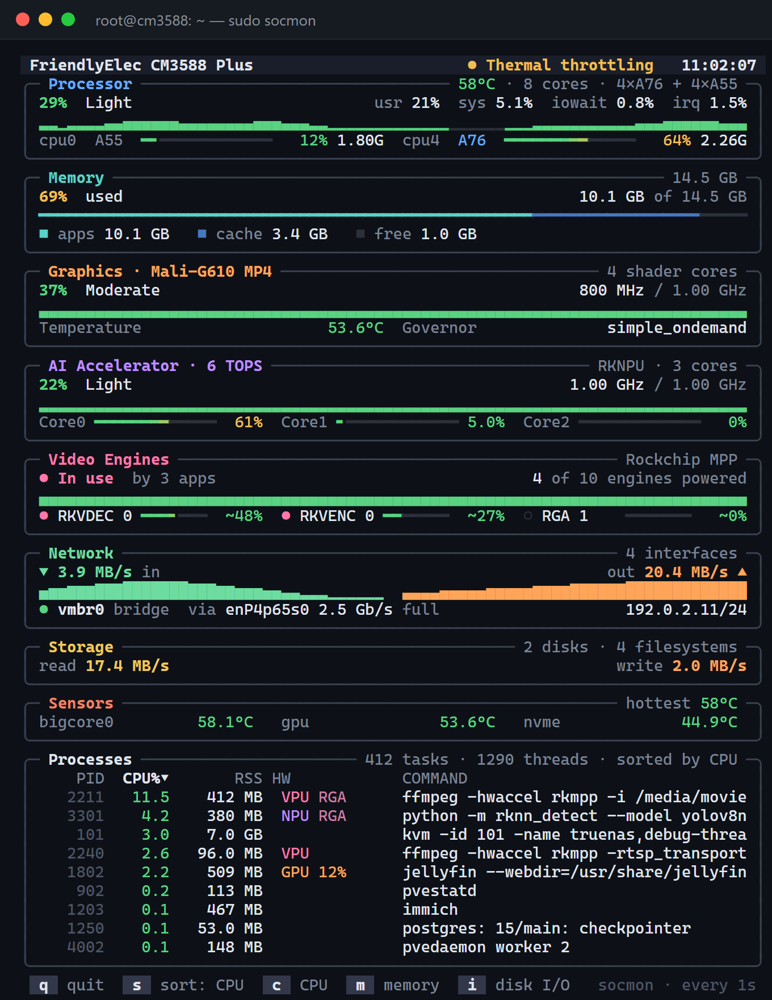

<p align="center"></p>

<p align="center">
  <b>A <code>btop</code>-style live dashboard for Rockchip and Allwinner boards.</b><br>
  CPU clusters, GPU, NPU, video engines, thermals — and the exact process using each one.
</p>

<p align="center">
  <a href="https://github.com/anand34577/socmon/actions/workflows/ci.yml"></a>
  
  
  
  
</p>

<p align="center"></p>

<p align="center"><sub>Rendered from the synthetic RK3588 fixture in <code>render_test.go</code> (<code>-frame</code> output), not a live capture.</sub></p>

---

## Why socmon

`htop` shows you the CPU. It can't tell you whether **ffmpeg is really using the hardware decoder**, whether the **NPU** is idle while your model "runs", or whether the kernel has quietly **capped your big cores**. socmon reads the SoC-specific counters (devfreq, debugfs, runtime-PM, DRM fdinfo) and joins them with `/proc`, so each accelerator card shows load, clock, temperature **and which apps hold it open**.

| You want to know…                              | socmon shows                                                   |
|------------------------------------------------|----------------------------------------------------------------|
| Is Jellyfin / go2rtc using RKMPP or the CPU?   | Video Engines card + `VPU` / `RGA` tags on the process         |
| Is my RKNN model actually on the NPU?          | Per-core NPU load, driver version, process tagged `NPU`        |
| Am I thermally throttled?                      | Header health badge, `cap` marker on throttled clusters, cooling states |
| Where is memory going?                         | Apps / cache / free bar, zram ratio, CMA, DDR clock and bus load |
| What is saturating the box?                    | Per-disk busy %, IOPS, per-interface rates, per-process disk I/O |

## Supported hardware

| SoC                 | Recognized boards (by name)    | CPU            | GPU            | NPU              |
|---------------------|--------------------------------|----------------|----------------|------------------|
| RK3588              | ROCK 5A/5B, CM3588             | 4×A76 + 4×A55  | Mali-G610 MP4  | RKNPU, 6 TOPS, 3 cores |
| RK3576              | —                              | 4×A72 + 4×A53  | Mali-G52 MC3   | RKNPU, 6 TOPS, 2 cores |
| RK3566 / RK3568     | ROCK 3A / 3C                   | 4×A55          | Mali-G52 2EE   | RKNPU, 0.8 TOPS  |
| Allwinner A733      | Radxa Cubie A7A / A7S          | 2×A76 + 6×A55  | IMG BXM-4-64   | VIP9000, 3 TOPS  |
| Allwinner A527/T527 | Radxa Cubie A5E                | 8×A55          | Mali-G57 MC1   | VIP, 2 TOPS      |

Unknown boards still get the generic CPU, memory, network, storage, sensor and process panels; accelerator cards say "not detected".

## Features

- **Processor** — total % with usr/sys/iowait/irq split and history, every core (type, load, clock), each cpufreq cluster with a `cap` marker when `scaling_max_freq` is lowered, governor, load average, run queue, blocked tasks, context switches
- **Memory** — apps/cache/free stacked bar, available, page cache, buffers, shared, dirty, swap, zram size and ratio, CMA, DDR clock and bus load (Rockchip dmc), DDR temperature
- **Graphics** — load + history, clock vs max, governor, temperature, shader cores, GPU memory, apps using the GPU (per-app GPU % on Panfrost/Panthor via DRM fdinfo)
- **AI Accelerator** — load, per-core bars, clock, governor, temperature, memory, driver version, loaded models with inferences/s and latency (Allwinner viplite)
- **Video Engines** — RKVDEC, RKVENC, VDPU, VEPU, AV1D, JPEG, RGA, IEP (Rockchip MPP), Cedar VE (Allwinner), Hantro/rkvdec (mainline V4L2): powered state, busy %, and the processes holding `/dev/mpp_service`, `/dev/rga`, `/dev/cedar_dev` or a V4L2 codec node
- **Network** — physical ports, bridges, bonds, VLANs, Wi-Fi: link speed, duplex, signal, IPv4, rates, totals, errors/drops, driver, MAC; gateway, DNS, TCP open/listening
- **Storage** — NVMe/eMMC/SD/USB/SATA with size, model, temperature, busy %, MB/s, IOPS, filesystems with usage bars; ZFS pools
- **Sensors** — every thermal zone, fans (rpm/duty), throttling from cooling devices
- **Processes** — PID, user, state, threads, CPU % (share of the whole chip), MEM %, RSS, disk I/O, hardware blocks in use, GPU %, full command line
- **Scriptable** — JSON snapshot via `-once` (automatic when output isn't a TTY) and single-frame rendering via `-frame`

### Adaptive layout

The layout reflows to the terminal: **3 columns** at ≥150 cols, **2** at ≥96, **1** below, with two process tables side by side on very wide screens. The last card in each column turns spare rows into a history chart, so no area is blank; on short terminals the least important cards (Sensors, Storage, Network) give up rows first and at least ~10 processes stay visible.

<p align="center"></p>
<p align="center"><sub>Same data in an 80-column terminal.</sub></p>

## Quick start

Download the prebuilt binary from the [latest release](https://github.com/anand34577/socmon/releases/latest), verify it, and run it as root:

```sh
curl -LO https://github.com/anand34577/socmon/releases/latest/download/socmon-linux-arm64
curl -LO https://github.com/anand34577/socmon/releases/latest/download/socmon-linux-arm64.sha256
sha256sum -c socmon-linux-arm64.sha256
chmod +x socmon-linux-arm64 && sudo ./socmon-linux-arm64
```

Releases are built by GitHub Actions when a `v*` tag is pushed. To build it yourself instead:

```sh
# 1. build for the board (from any OS with Go)
GOOS=linux GOARCH=arm64 CGO_ENABLED=0 go build -trimpath -ldflags "-s -w" -o socmon-linux-arm64 .

# 2. copy it over and run as root
scp socmon-linux-arm64 user@board:~/
ssh -t user@board 'chmod +x socmon-linux-arm64 && sudo ./socmon-linux-arm64'
```

Root is needed for NPU/GPU load and accelerator ownership (root-only debugfs and `/proc/<pid>/fd`). Without it socmon still runs and marks those readings unavailable.

## Usage

```sh
sudo ./socmon              # live dashboard
./socmon -i 2s             # refresh every 2 s (default 1s)
./socmon -once             # one JSON snapshot, then exit
./socmon -frame 180x50     # print one frame at 180x50 and exit
```

| Flag         | Meaning                                                  |
|--------------|----------------------------------------------------------|
| `-i <dur>`   | Refresh interval, e.g. `500ms`, `2s` (default `1s`)      |
| `-once`      | Print one JSON snapshot and exit (process list omitted)  |
| `-frame WxH` | Render one frame at the given size and exit (min 40×10)  |
| `-color <m>` | `auto` (default, trusts `$COLORTERM`), `true` (24-bit) or `256` |

### Keys

| Key | Action                          |
|-----|---------------------------------|
| `q` | Quit (also `Ctrl-C`)            |
| `s` | Cycle process sort              |
| `c` | Sort by CPU                     |
| `m` | Sort by memory                  |
| `i` | Sort by disk I/O                |

Resizing and key presses repaint without resampling, so they never skew rate calculations.

### Scripting

```sh
sudo ./socmon -once | jq '{soc: .board.soc, load: .loadavg, accelerators: .accelerators}'
./socmon -frame 160x45 > frame.ans && cat frame.ans          # share a frame in a bug report
```

## Building from source

Requires Go 1.21+. All sources carry a `//go:build linux` tag, so always build for Linux.

```sh
# on the board
go build -trimpath -ldflags "-s -w" -o socmon .
```

```powershell
# cross-compile from Windows PowerShell
$env:GOOS="linux"; $env:GOARCH="arm64"; $env:CGO_ENABLED="0"
go build -trimpath -ldflags "-s -w" -o socmon-linux-arm64 .
```

## How it works

| Area            | Source                                                                                                  |
|-----------------|----------------------------------------------------------------------------------------------------------|
| CPU / memory    | `/proc/stat`, `/proc/meminfo`, `/proc/loadavg`, cpufreq                                                  |
| Disk / network  | `/proc/diskstats`, `/sys/block`, `/proc/mounts`, `/proc/net/{dev,tcp}`, `/sys/class/net`                 |
| Processes       | `/proc/<pid>/{stat,io,fd,fdinfo,cmdline}`                                                                |
| Temps / fans    | thermal zones, cooling devices, hwmon                                                                    |
| GPU / NPU / DDR | `/sys/class/devfreq` (matched by name); debugfs `rknpu/load`+`version`, `mali0/gpu_memory`, `pvr`, `viplite`, `clk` |
| Video engines   | `/sys/bus/platform/devices` media blocks, MPP/RGA debugfs                                                |
| Board / SoC     | `/proc/device-tree/{model,compatible}`                                                                   |

Where the kernel exposes no load counter the card says so and shows the clock instead. **Estimates are marked `~`:** media-block busy % and the A733 GPU load are the share of time the block was runtime-resumed (`power/runtime_active_time`). That is accurate for drivers that suspend between jobs; a block that never suspends reports "on" rather than a fake 100%.

<details>
<summary><b>Allwinner A733 notes</b> (verified on Radxa Cubie A7A, BSP kernel)</summary>

- **GPU (PowerVR BXM-4-64)** — no devfreq node and no "GPU Utilisation" in `pvr/status`. Load is approximated as runtime-PM powered-on time; clock from debugfs `clk/gpu0`; memory from `pvr/driver_stats`
- **NPU (VIP9000, viplite)** — load + state from `viplite/core_loading`, memory from `mem_profile`, per-model inferences/s and latency from `rt_net_profile`; clock from devfreq `3600000.npu`
- **DDR** — devfreq `a020000.dmcfreq` (clock only). Video decode runs on the VE, not the GPU
- **Thermal** — `*_idle_zone` entries duplicate the CPU sensors and are hidden

</details>

## Troubleshooting

Missing or wrong readings? Run the read-only diagnostics script as root on the board and attach the output to your report:

```sh
sudo bash scripts/socmon-diag.sh > "$(hostname)-diag.txt" 2>&1
```

It only lists and reads sysfs/procfs/debugfs files (cpufreq, devfreq, GPU, NPU, media blocks, thermal…).

| Symptom                              | Likely cause                                                           |
|--------------------------------------|------------------------------------------------------------------------|
| NPU/GPU load missing, apps not listed | Not running as root, or debugfs not mounted (`mount -t debugfs none /sys/kernel/debug`) |
| Colours look faded / flat            | socmon only uses 24-bit colour when `$COLORTERM` says so; `sudo` and many SSH sessions drop it, so it falls back to a coarser 256-colour palette. Run `sudo ./socmon -color true` (or `sudo -E`) on a 24-bit terminal |
| Card shows clock but no load         | The kernel driver exposes no load counter for that block               |

## Project layout

| File          | Responsibility                                                                         |
|---------------|-----------------------------------------------------------------------------------------|
| `main.go`     | Entry point, flags, event loop, refresh ticker, key and signal handling                 |
| `collect.go`  | `Collector` and `Snapshot`; CPU, cluster, core and memory sampling                      |
| `accel.go`    | GPU/NPU/DDR discovery (devfreq, viplite, Mali memory) and media-block (VPU/RGA) sampling |
| `io.go`       | Disks, mounts, network interfaces, TCP counts, thermal/fan/cooling sensors              |
| `procs.go`    | Process scan, CPU%/I/O rates, open-fd classification into hardware blocks               |
| `soc.go`      | SoC profiles and board-name detection from the device tree                              |
| `panels.go`   | Card bodies: CPU, memory, graphics, AI accelerator, video, network, storage, sensors    |
| `ui.go`       | Colour, formatting helpers, layout and frame rendering                                  |
| `term.go`     | Raw mode, terminal size, TTY detection                                                  |
| `sysfs.go`    | Small sysfs read helpers                                                                |
| `.github/workflows/` | `ci.yml` (fmt, vet, test, build on every push/PR) and `release.yml` (builds and publishes binaries on `v*` tags) |
| `docs/`       | README images (`banner.svg`, `hero.png`, `compact.png`)                                 |
| `scripts/`    | `socmon-diag.sh`, the read-only diagnostics collector                                  |

## Contributing

**Add a SoC:** add a row to `profiles` in `soc.go` (name, vendor, device-tree match strings, CPU/GPU/NPU labels, NPU TOPS and core count), and a row to `boardNames` for a marketing name. Runtime values always come from sysfs; the profile only supplies labels and capacity hints.

**Test:**

```sh
go test ./...                              # on a Linux host or WSL
SOCMON_PREVIEW=/tmp/p.txt go test ./...    # also write the rendered frames for review
COLORTERM=truecolor SOCMON_PREVIEW=/tmp/p.txt go test -run TestRender   # keep colours in the .ans files
```

`render_test.go` renders a synthetic busy RK3588 at several terminal sizes and checks no line overflows its width; the images in `docs/` come from that fixture.

## License

MIT. See [LICENSE](LICENSE).
